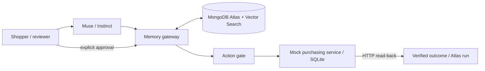

# MemoryBank: shared memory agents can trust

> One agent can propose a memory. That does not mean every other agent should trust it.

MemoryBank is a two-agent purchasing prototype built for **Agents in Context Toronto**,
MongoDB hackathon, on the **Memory You Can Govern** track. Agents share approved memory;
server code controls who can change it, where it can be used, and which actions it permits.

**Muse** proposes policy changes. **Instinct** retrieves approved policies and proposes
purchases. The **Shopper** requests purchases and switches to an authorized reviewer session
to explicitly approve changes. These are simulated agents and mock purchases.

## What the demo proves

1. Ask Instinct for a **USD 7,000 Northstar purchase**. Approved memory v1 permits purchases
   up to USD 5,000 without approval, so a mock finance-approval request is saved and verified.
2. Ask Muse to raise the limit to **USD 10,000**. The proposal waits for review; repeating
   the purchase still uses v1 and requires approval.
3. Explicitly approve the change as the reviewer. v2 replaces v1; the same purchase now
   creates a verified mock draft order.
4. Try another team: procurement memory is unavailable. Forget the Northstar policy versions,
   then repeat the purchase: Instinct asks for clarification and creates no purchasing record.

The request stays the same. Approved memory changes the permitted action.

## Run the demo

You need **Python 3.12+**, a **MongoDB Atlas cluster supporting Vector Search and transactions**,
a **Voyage API key**, and a **Gemini API key**. Enable Atlas network access for your machine.
The Atlas database user needs permission to create/drop disposable databases and manage search
indexes.

From the repository root:

```bash
python -m venv .venv
source .venv/bin/activate
python -m pip install -e ".[dev]"
cp .env.example .env
```

If `.env` already exists, edit it instead of copying over it. Fill in these values; see
[.env.example](.env.example) for the remaining settings. `.env` is gitignored.

```dotenv
MONGODB_URI=mongodb+srv://<user>:<password>@<cluster-host>/
VOYAGE_API_KEY=<voyage-key>
VOYAGE_MODEL=voyage-4
EMBEDDING_DIM=1024
LLM_PROVIDER=gemini
LLM_API_KEY=<gemini-key>
LLM_MODEL=gemini-3.5-flash-lite
```

Use two terminals with the virtual environment active:

```bash
# Terminal 1: separate mock purchasing service
PURCHASING_DB_PATH=/tmp/memorybank-demo-purchasing.sqlite python -m uvicorn purchasing_service.app:app --port 8001
```

```bash
# Terminal 2: guided demo page
python -m demo_app
```

Open **http://localhost:8000**. Startup automatically creates a fresh
`memorybank_ui_demo_*` Atlas database, seeds policies, embeds them with Voyage, and waits for
Vector Search. No manual database setup is needed for this page. Allow several minutes for
preparation and provider calls.

Follow the **Demo steps** panel. Each step selects a session and fills in a message; press
**Send** to execute it. Approve changes under **Changes waiting for approval** as
**Shopper, reviewing**. Wait for “Becoming searchable…” to clear before purchasing with v2.
**More checks** includes lookups, expiry, revocation, and service-level duplicate checks.

Run **one app process**: policy mutations and dispatch share in-process locks. Stopping the
app normally drops its disposable Atlas database; restarting creates a fresh story. The
configured application database is untouched. The separate SQLite purchasing file persists,
including records created before forgetting.

## How it works



- **Governed writes:** proposals stay separate from actionable memory. Only an authorized
  finance administrator can approve the exact proposal. Transactions and expected-version
  checks replace the old version atomically.
- **Scoped retrieval:** Atlas Vector Search finds candidates using Voyage embeddings. The
  gateway rechecks primary records for organization/team, validity, current version, and
  content/embedding consistency before returning them.
- **Guarded actions:** server code checks identity, supplier, currency, amount, and current
  approved policy immediately before dispatch. Similarity and model output grant no authority.
- **Verified execution:** the separate purchasing service persists draft orders and approval
  requests with idempotency keys. HTTP read-back verifies the result; Atlas runs link it to
  the user, agent, memory version, and validation event.
- **Lifecycle controls:** expired, revoked, superseded, or forgotten memory cannot authorize
  new actions. Forgetting a selected version removes its payload and redacts controlled linked
  proposals, events, and runs. The page forgets all tracked Northstar versions individually.

Atlas stores five collections: `principals` (identities and permissions), `memories` (approved
versioned policies), `memory_proposals` (suggested changes), `memory_events` (governance history),
and `runs` (execution evidence). Schema validation and unique indexes enforce document shape
and policy-version constraints; the Python gateway enforces application permissions.

## Development and checks

```bash
# Local suite; live Atlas/provider scenarios are skipped by default
python -m pytest -q

# Atlas integration tests in disposable databases
python -m pytest --atlas -q

# Real Voyage + Atlas Vector Search checks
python -m pytest tests/test_vector_search_live.py --atlas --search -q

# Connected Gemini / Voyage / Atlas / HTTP purchasing rehearsal
python -m pytest tests/test_acceptance_live.py --atlas --acceptance -v -s --tb=short
```

Live checks consume provider quota and require Atlas permissions to create/drop test databases.
Demo route tests use fakes; the connected acceptance rehearsal exercises real backend services.
It does not verify the browser interface. The backend rehearsal was recorded as passing on
2026-11-14; full live interface acceptance remains to be verified. Stale-version and
wrong-supplier action submissions are covered by backend tests and have no manual page control.

To work with the configured `MONGODB_DB` directly instead of the disposable demo database:

```bash
python -m scripts.setup_db
python -m scripts.seed
python -m scripts.embed_memories
python -m scripts.setup_indexes
python -m scripts.search_memories "Can I spend USD 7,000 with Northstar?" --supplier northstar
```

Rerun index setup until it reports `READY` and queryable. Seeding preserves existing policy
history; seeded policies expire after 24 hours and reseeding does not renew them.
The Northstar seed is `mem_northstar_v1`, policy key `supplier:northstar:purchasing`.
Demo identities are `employee`, `finance_admin`, `other_team_user`, `agent_a`, and `agent_b`.

## Limits and troubleshooting

- **Demo sessions:** the session selector maps to seeded identities; this is not production
  authentication. Chat text cannot grant roles or approve a proposal.
- **Provider errors or rate limits:** use the displayed wait/retry guidance. There is no
  simulated-response or keyword-search fallback. If preparation fails, check Atlas access,
  permissions, and API configuration, then restart the app.
- **Clarification just after approval:** wait for v2 to become searchable, then retry.
- **Forgetting:** restart the app to present a fresh demo. Deletion covers controlled scoped
  records, not backups, provider logs, external purchasing records, or existing model context.
  Revocation and forgetting do not undo completed actions.
- **Prototype scope:** synthetic data, mock draft orders, whole-dollar USD policies, and
  single-process coordination. This is not a general malicious-instruction detector or a
  distributed revocation guarantee.

See [demo.md](demo.md) for presentation narration and the original interface handoff,
[agent.md](agent.md) for contributor rules and hackathon requirements, and
[memorybank/memory_gateway.py](memorybank/memory_gateway.py) for gateway integration methods.
