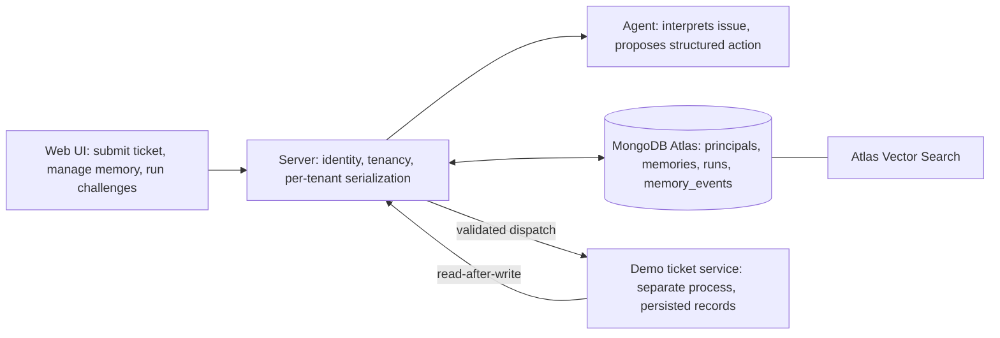

# MemoryBank: can your agent unlearn?

> A support agent remembers customer-specific routing instructions, uses them to route real tickets, and **changes its next action** when an authorized person corrects, expires, or deletes that memory.

Built for **Agents in Context Toronto** (MongoDB hackathon), track: **Memory You Can Govern**.

**Status:** hackathon prototype. The design below is the build target. See [Status](#status) for what is implemented.

---

## The problem

Most agent-memory demos show an agent remembering more. Few show what happens when a memory becomes wrong.

A customer once said, "Route CSV export incidents to our Data Operations queue." Later they reorganize, and Data Operations no longer handles exports. An agent that keeps acting on the old instruction sends tickets to a queue nobody watches.

Governing memory means answering four questions, and the answers have to change what the agent does:

| Question | MemoryBank's answer |
|---|---|
| Who may read or change a memory? | The server resolves identity and tenant. Other tenants and unauthorized users are rejected. |
| Is it still true? | Memories are versioned. A correction supersedes the old one. |
| Is it still valid? | Memories have a validity window. An expired memory cannot authorize an action. |
| Can it be removed? | Forgetting deletes the content and embedding, plus content copies in run records. |

## The demo story

**Remember, act, correct, act differently, reject misuse.**

1. **Remember and act.** A customer instruction says "Route CSV export incidents to Data Operations." A new export ticket arrives. The agent retrieves the instruction and routes **Ticket A** to Data Operations using **memory v1**.
2. **Correct.** An authorized customer administrator says "Data Operations no longer handles exports. Route these incidents to Application Support." The old memory is superseded and v2 is created atomically.
3. **Act differently.** An equivalent export ticket arrives. The agent routes **Ticket B** to Application Support using **memory v2**.
4. **Break it.** Anyone, including a judge, can try:
   - Read or modify that memory as **another tenant**.
   - Correct it with an **unauthorized identity**.
   - **Reuse the old memory** after correction.
   - Route a ticket **after the instruction has expired**. The agent must **escalate for clarification** and must not invent a replacement instruction.

For each ticket you can inspect the ticket record, the exact memory versions retrieved, and the execution receipt.

## Why this is not basic RAG

The deliverable is a **changed ticket state in a separate system**, not a better paragraph.

- The agent interprets a new issue, retrieves relevant customer instructions with **Atlas Vector Search**, and proposes a **structured routing action**.
- The agent does not execute anything itself. It calls a **constrained tool**, and **server code** validates the tenant, memory status, validity window, and permitted queue before dispatch.
- The ticket update is **read back** from the ticket service to verify it landed.
- Every run stores which **memory versions** it used, so behavior changes are traceable to memory changes.

## Architecture



The ticket service is a **demo integration** standing in for a helpdesk such as Zendesk or ServiceNow. It is a separate service with its own persisted records, so a routing change is visible outside the agent.

### Execution flow

1. **Resolve identity and tenant on the server.** The tenant never comes from the prompt or the model.
2. **Retrieve** relevant memories with Atlas Vector Search, pre-filtered by tenant, status, and validity.
3. **Re-read** each retrieved record from the primary `memories` collection to confirm its current status before exposing it to the model.
4. **Propose.** The agent returns a structured action, for example `route(queue, memory_id, memory_version)` or `escalate(reason)`.
5. **Validate and recheck.** The server checks the tenant, that the supporting memory is still `active` and within its validity window, and that the queue is permitted. It then re-reads the supporting memory immediately before dispatch.
6. **Execute and verify.** The server updates the ticket and reads it back.
7. **Record** the run, including the receipt and verified outcome.

If no valid memory supports a route, the outcome is **escalate for clarification**.

## Data model

Four Atlas collections.

| Collection | Purpose |
|---|---|
| `principals` | Demo identities, tenant membership, correction permissions. |
| `memories` | Tenant, content, embedding, version, validity window, status, source, correction linkage. |
| `runs` | Retrieved memory versions, proposed action, validation result, tool receipt, verified outcome. |
| `memory_events` | Who created, corrected, expired, or deleted a memory, and why. |

Illustrative `memories` document (field names may change as the build settles):

```jsonc
{
  "_id": "mem_...",
  "tenant_id": "acme",
  "content": "Route CSV export incidents to Data Operations.",
  "embedding": [/* vector from the embedding model */],
  "version": 1,
  "status": "active",            // active | superseded | expired | deleted
  "valid_from": "...",
  "valid_until": "...",          // null if open-ended
  "source": { "type": "customer_instruction", "by": "principal_..." },
  "supersedes": null,            // _id of the memory this one replaced
  "superseded_by": null
}
```

Filter fields used in the `$vectorSearch` pre-filter (`tenant_id`, `status`, `valid_until`) must be declared as `filter` fields in the Vector Search index.

## Correction, expiry, and forgetting

These are three different operations and the system treats them separately.

| Operation | What happens | What is kept |
|---|---|---|
| **Correction** | The selected memory is superseded and its replacement is created **atomically**. Only the replacement is usable. | The superseded version stays for audit and is never retrieved for action. |
| **Expiry** | The instruction stops being usable at its deadline. | History is retained for the disclosed audit period. |
| **Forgetting** | The memory's **content and embedding are removed**, as are content copies in run records. | Minimal deletion metadata only, under the stated demo policy. |

**TTL indexes are for eventual cleanup, not for authorization.** MongoDB does not guarantee immediate TTL deletion, so whether a memory may be used is decided by its `status` and validity window at query time and again before dispatch. TTL only cleans up afterward under the retention rules.

## Judge challenges

Each row is something you can try against the running demo, and the outcome the system should produce.

| Attempt | Expected outcome |
|---|---|
| Read the memory as another tenant | Denied. The search is tenant-filtered and the record is not returned. |
| Modify the memory as another tenant | Denied. |
| Correct the memory with an unauthorized identity | Rejected. No new version is created and an event is logged. |
| Reuse the old memory after correction | The superseded version cannot authorize dispatch. The agent uses the current version. |
| Route a ticket after the instruction expires | Escalates for clarification. No queue is invented. |
| Route a ticket after the memory is forgotten | Escalates. The content and embedding are gone. |

## What this does and does not claim

**What it demonstrates**

- Memory status, validity, and tenancy are enforced by server code and Atlas queries, not by prompt text.
- Every action is traceable to specific memory versions.
- A change to memory changes the agent's next action.

**Boundaries of this prototype**

- **Single-instance demo.** Memory mutations and action dispatch go through one server-side execution path with per-tenant serialization. This does **not** establish a distributed revocation guarantee.
- **Not comprehensive deletion.** Forgetting covers the `memories` content, its embedding, and content copies in `runs`. It does **not** cover database backups, provider logs, or a distributed fleet.
- **Demo identities.** Principals are seeded demo identities, not a production auth system.
- **Demo ticket system.** The helpdesk is a purpose-built demo service, not a real helpdesk.
- **No automatic contradiction detection.** Corrections target a **selected** memory.

## Run it

Prerequisites:

- A MongoDB Atlas cluster with a Vector Search index on `memories`
- An embedding API key
- An LLM API key (structured output)

Setup, seed, and run commands will be added here when the code lands in this repository.

## Demo script (about 60 seconds)

| Time | Beat |
|---|---|
| 0:00-0:10 | "Our agent remembers where your tickets belong. What happens when that memory becomes wrong?" |
| 0:10-0:22 | Submit an export issue. Show the ticket in **Data Operations** and its **memory v1**. |
| 0:22-0:35 | Correct the instruction as an authorized admin. Submit an equivalent issue. Show **Application Support** and **memory v2**. |
| 0:35-0:45 | Switch tenants and attempt access. Show the denial. |
| 0:45-0:55 | Expire the instruction. Submit another issue. Show **escalation** with no unauthorized routing. |
| 0:55-1:00 | "Atlas governs which memories are usable. The ticket receipts show how changing memory changes action." |

## Status

- [ ] Atlas collections, indexes, and seed data (two tenants, demo principals)
- [ ] Demo ticket service with read-after-write verification
- [ ] Vertical slice: ticket in, retrieve, propose, validate, update, verify
- [ ] Selected-memory correction (atomic supersede and replace)
- [ ] Expiry rejection with escalation
- [ ] Forgetting (content, embedding, and run-record copies)
- [ ] Tenant-isolation and unauthorized-correction checks
- [ ] Challenge interaction in the UI

## Tech

- **MongoDB Atlas** for storage, **Vector Search** for retrieval, and TTL indexes for cleanup
- An embedding model and an LLM that returns structured JSON
- A server that owns identity, validation, and dispatch
- A separate demo ticket service
